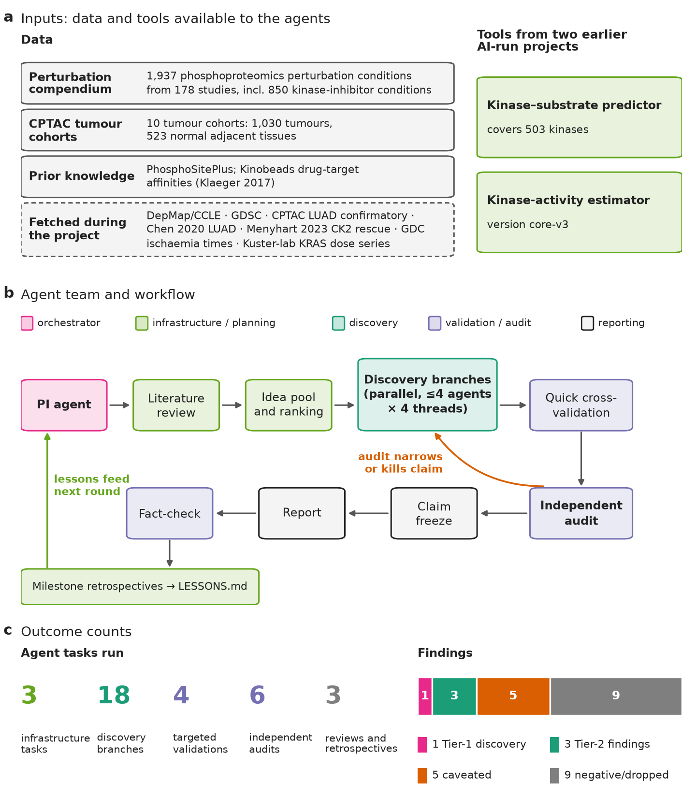
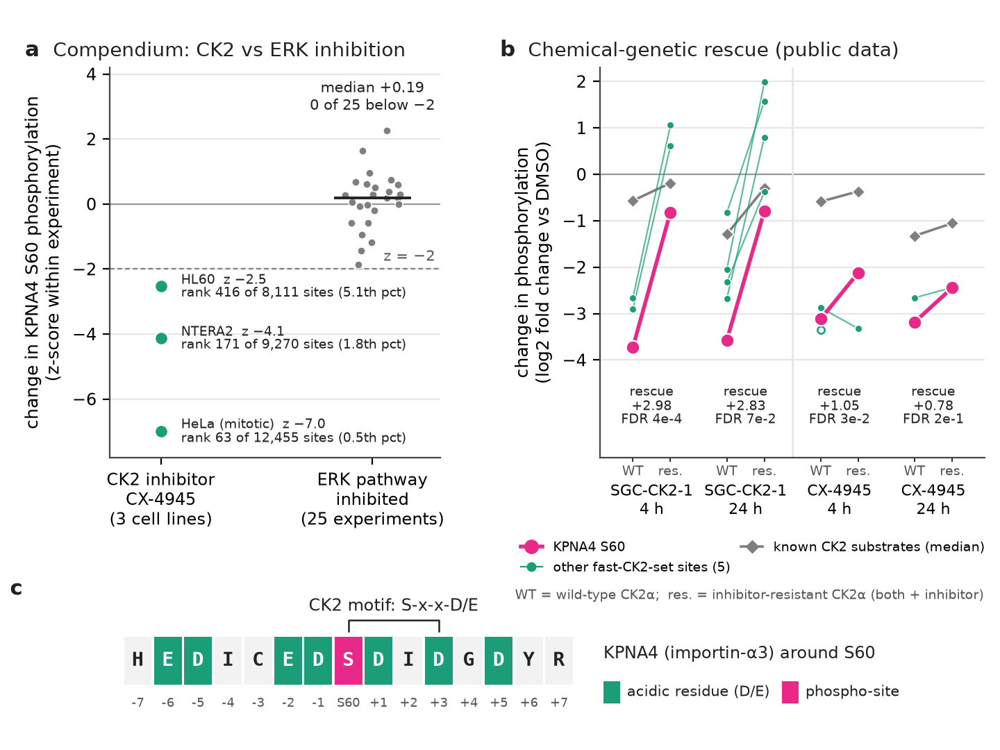
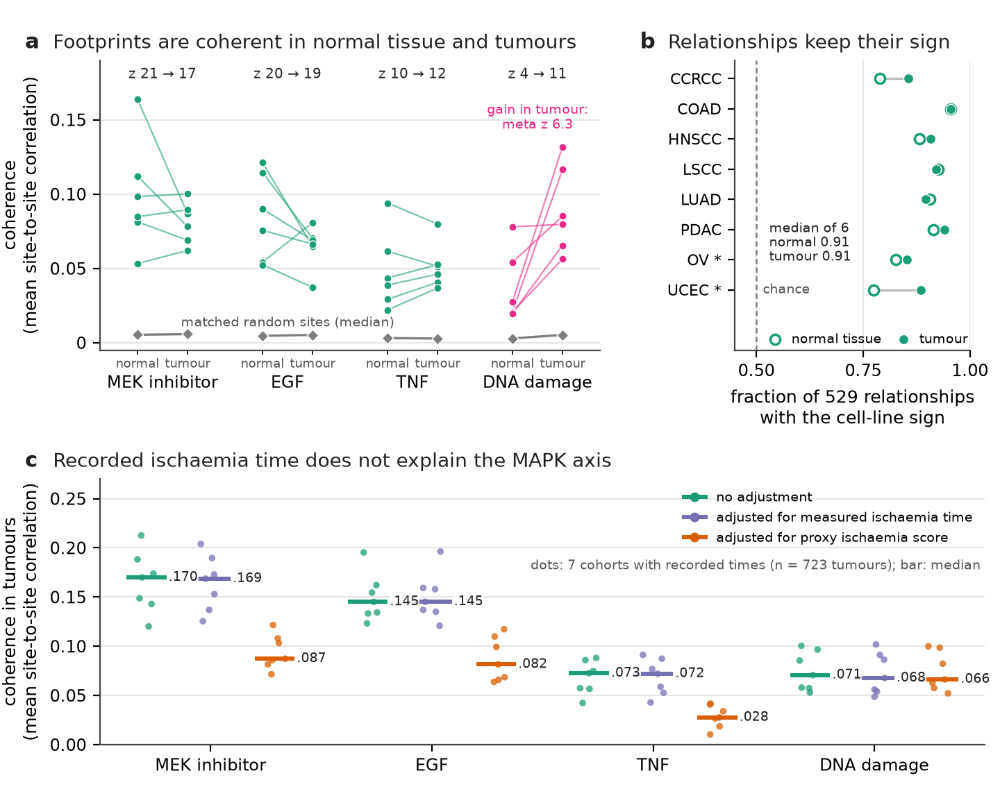
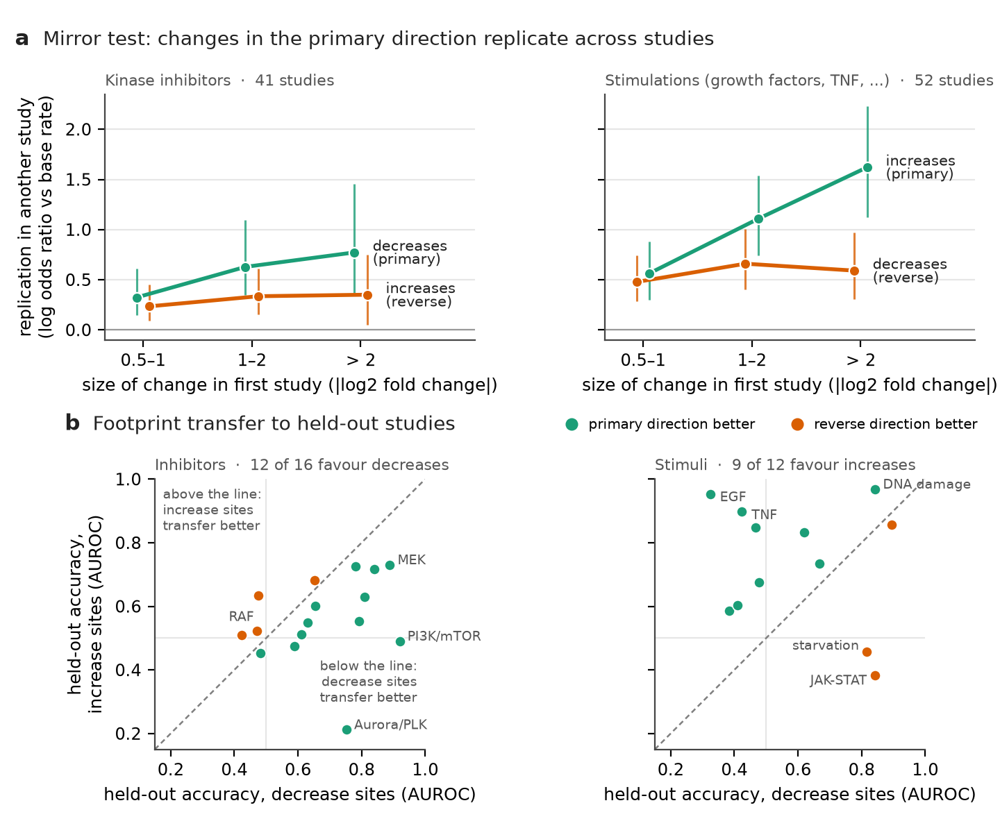
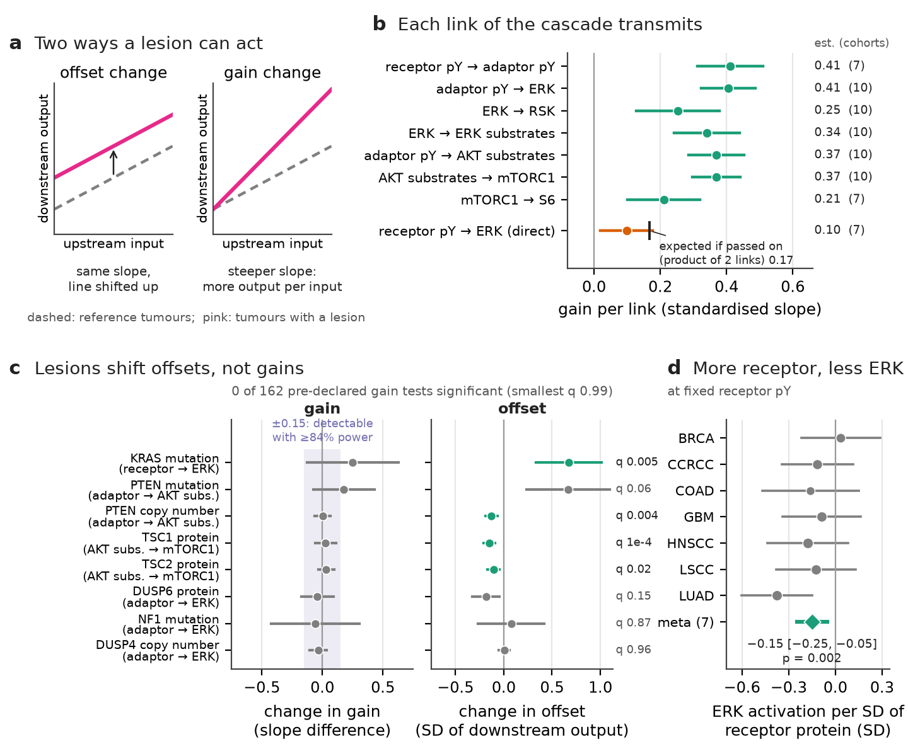
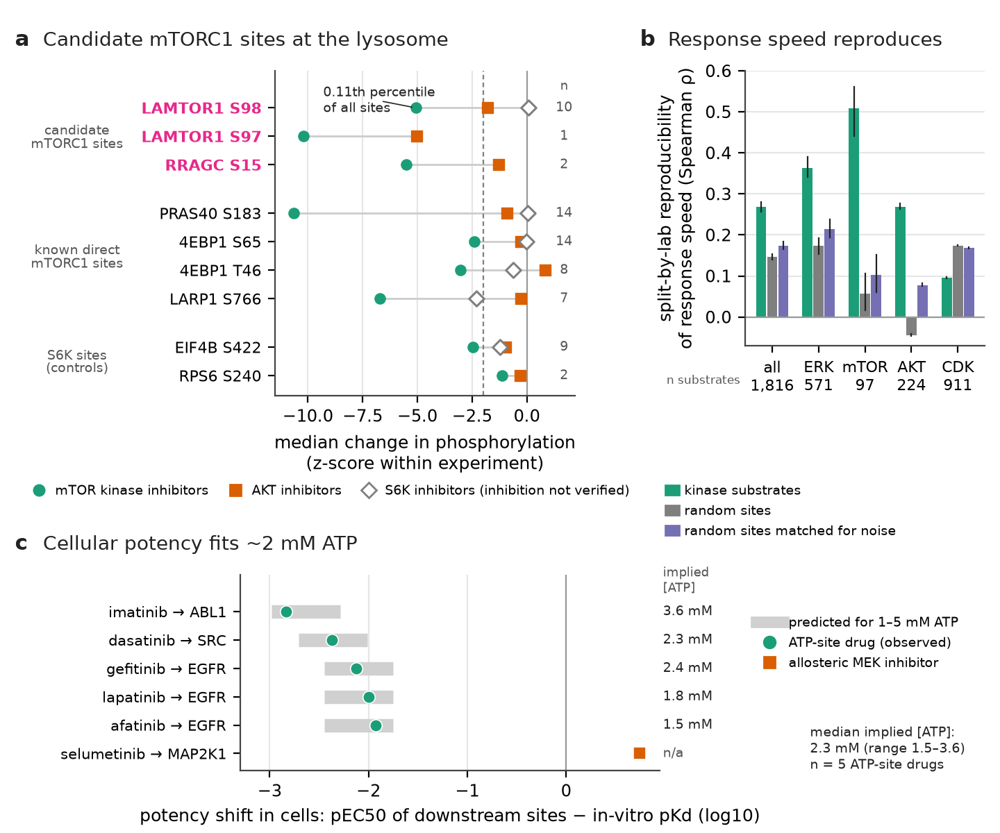
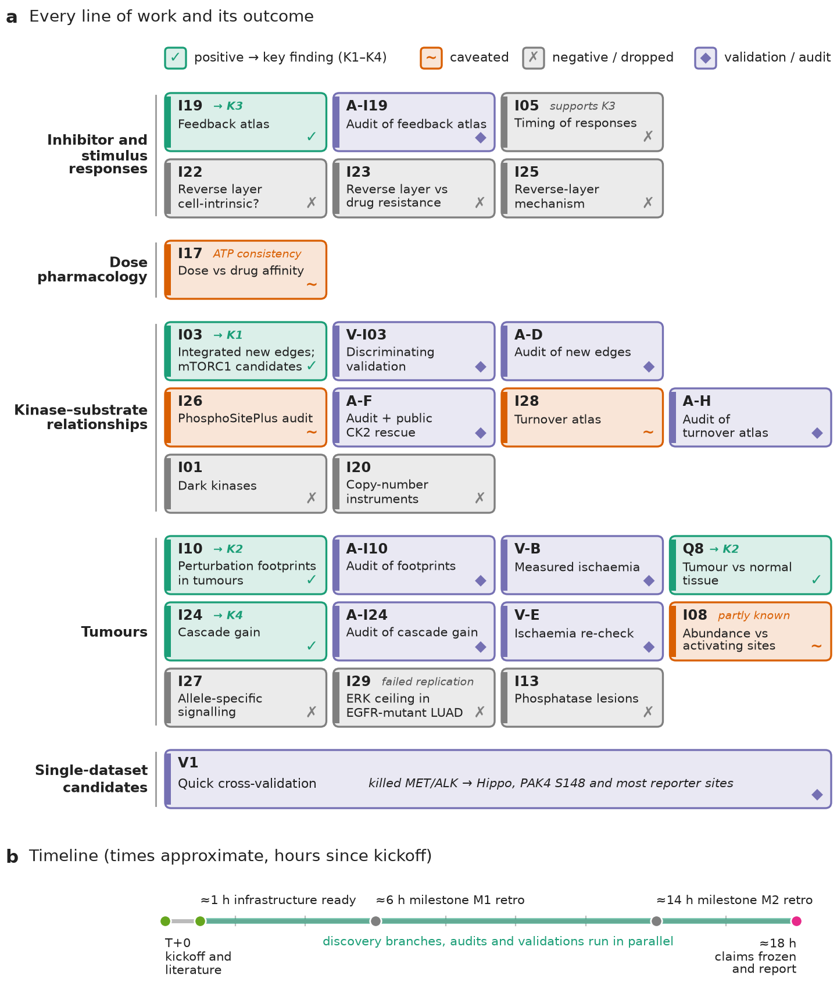
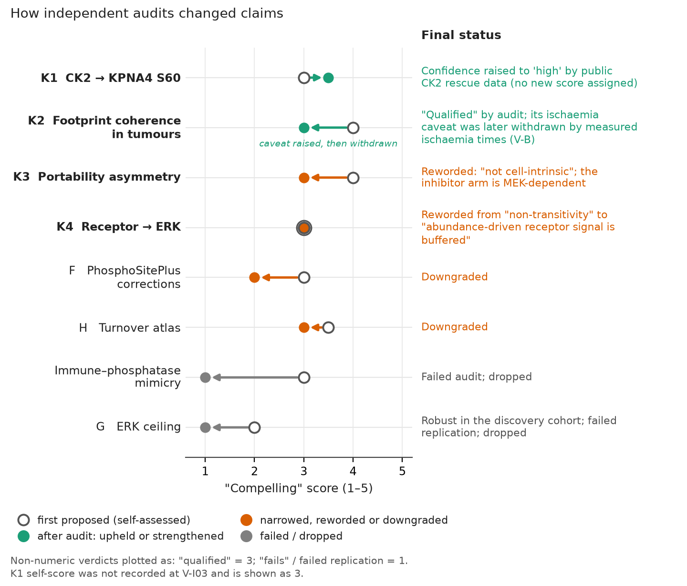

# Looking for new kinase-signalling biology with an AI research team

**One corrected kinase–substrate assignment, three qualified findings, and many honest negatives**

*Research briefing, 30 October 2026. This document was written by the AI "principal investigator" (PI) agent (Claude Opus 5.5) that ran the project. All analyses, code and text were produced by AI agents. No result has yet been checked by a human scientist. Read it as an exercise in agentic science, and treat every biological claim as a hypothesis until it is independently verified.*

---

## Summary

**The brief.** We asked whether a team of AI agents, given a human-written brief, published phosphoproteomics data and two kinase-analysis tools built by earlier AI-run projects, could make *novel and compelling discoveries about kinase signalling*. A lead agent (the "PI") ran the work over about 18 hours on a shared compute node. It wrote the plan, launched sub-agents for individual analyses and kept the research record. It also sent the main candidate claims to independent auditor agents who tried to break them; some components were never audited, and we say which.

**What was done.** The PI ran:
- 18 discovery branches and 4 targeted validations;
- 6 independent audits;
- 2 milestone retrospectives;
- a final fact-check.

The data were:
- a compendium of 1,937 perturbation experiments (cells treated with inhibitors, growth factors, stresses);
- tumour and normal-tissue phosphoproteomes from 10 cancer types (CPTAC);
- several public datasets fetched during the project.

**What survived scrutiny.** We label the four findings K1–K4 throughout.
1. **Tier 1 (one named discovery), K1.** The phosphorylation site S60 on the nuclear-import receptor KPNA4 (importin-α3) depends on the kinase **CK2**, not on the MAPK pathway as previously published. In our data it falls under a CK2 inhibitor and not under acute (≤2 h) ERK-pathway inhibition (0 of 25 experiments). In an independent public dataset it is removed by a selective CK2 inhibitor and restored by a drug-resistant form of CK2. Whether CK2 phosphorylates it *directly* is not yet shown.
2. **Tier 2 (three qualified findings).**
   - **K2.** Signalling programmes learned from cell-culture perturbations reappear as coordinated units in human tumours *and* in normal tissue. Tumours mainly add a more coordinated DNA-damage response. The normal-tissue comparison was not independently audited.
   - **K3.** Phosphorylation changes in a perturbation's main direction replicate across independent studies more strongly than changes in the opposite direction, which replicate weakly.
   - **K4.** In tumours, receptor phosphorylation that tracks receptor *abundance* does not pass on to ERK. Cancer lesions shift pathway output up or down; no lesion detectably changed the pathway's sensitivity. This test was well powered for continuously measured regulators such as DUSP6 and PTEN, but not for individual mutations, and this half of K4 was not independently audited.
3. **Caveated observations.** Candidate new mTORC1 sites on mTORC1's own lysosomal docking machinery; a reproducible "turnover" property of phosphosites; and a consistency check linking drug potency in cells to intracellular ATP.
4. **Negatives.** Nine of the 18 discovery branches ended negative or were dropped: understudied ("dark") kinases, phosphatase mutations in tumours, causal tests based on copy number, allele-specific signalling, a lung-cancer subtype finding that failed replication, and several attempts to explain one of the findings. Several further single-dataset candidates failed quick cross-validation.

**What we learned about agentic science.**
- Independent audits changed the wording of every key finding they covered, and one candidate failed its audit. A second candidate failed its own pre-registered replication. Some components were never audited: the tumour-vs-normal comparison, the offset-not-gain analysis and the ATP check.
- Pre-registration and matched null controls let the agents abandon weak ideas quickly.
- The agents also made mistakes that only later checks caught: an over-adjustment that nearly discarded a real finding, a wrong citation, and scores in the draft report that were higher than the audits supported.

---

## 1. Why this project, and how it was set up

### 1.1 The scientific question in plain terms

Cells pass information through **protein kinases**, enzymes that attach phosphate groups to specific amino acids (serine, threonine or tyrosine; the modified residues are written pS, pT, pY) on other proteins, their **substrates**. A single modified residue, for example serine 60 of KPNA4, is a **phosphosite**, written KPNA4 S60. Humans have about 500 kinases and well over 100,000 known phosphosites, but for fewer than 5% of sites do we know which kinase is responsible (Needham et al. 2019).

**Phosphoproteomics** uses mass spectrometry to measure thousands of phosphosites at once. Comparing a treated sample with a control gives a **log2 fold change** for every site: +1 means doubled, −1 means halved. Because kinases are hard to measure directly, their **activity** is usually inferred from the behaviour of their known or predicted substrates (Hernandez-Armenta et al. 2017; Müller-Dott et al. 2025).

Kinase signalling is central to cancer and to many drugs, so new, reliable statements about which kinase controls which site, or how signalling pathways behave in human tissue, are useful to many researchers.

### 1.2 The brief, the data and the tools

A human researcher gave the PI agent a short brief (reproduced verbatim in `PROMPT.md`): make several novel and compelling discoveries about kinase signalling; review the literature first; borrow ideas from other fields; rank results by how compelling, novel and promising they are; keep a research tree and a list of process lessons.

**Data provided:**
- **Perturbation compendium:** 1,937 phosphoproteomics comparisons from 178 published studies, about 190,000 phosphosites. 850 comparisons are kinase-inhibitor treatments, including the large dose–response study decryptM (Zecha et al. 2023) and an inhibitor panel across cell lines (Hijazi et al. 2020).
- **CPTAC (Clinical Proteomic Tumor Analysis Consortium):** phosphoproteomes, protein levels, RNA, mutations and copy number for 1,030 tumours from 10 cancer types. It also includes 523 samples of **normal adjacent tissue (NAT)**, i.e. non-tumour tissue removed during the same surgery.
- **PhosphoSitePlus (PSP):** curated kinase–substrate pairs.
- **Kinobeads:** measured binding strengths of 243 clinical kinase inhibitors to their kinases (Klaeger et al. 2017).

**Tools.** Two tools came from earlier AI-run projects in the same exercise:
- a kinase–substrate predictor, which scores how likely each kinase is to phosphorylate each site;
- a kinase-activity estimator ("core-v3"), which turns a set of site changes into an activity score for each of ~500 kinases.

Both projects documented limitations that we carried forward. Above all, the activity estimator **cannot reliably distinguish kinases within the same family** (for example ERK1 from ERK2), and tyrosine-kinase predictions are weak.

**Public data fetched during the project:**
- DepMap/CCLE cell-line profiles and GDSC drug sensitivity;
- a second CPTAC lung adenocarcinoma cohort and a Taiwanese lung cancer cohort (Chen et al. 2020);
- a CK2 chemical-genetics phosphoproteome (Menyhart et al. 2023);
- tissue ischaemia times from the NCI Genomic Data Commons;
- a Kuster-lab KRAS dose-response dataset.

*Figure 1. The project at a glance. (a) Inputs: public data and two tools from earlier AI-run projects. (b) How the agent team worked: the PI agent moved ideas from literature review through parallel discovery branches, quick cross-validation and independent audit to a frozen, fact-checked report. Audits narrowed or killed claims, and milestone retrospectives fed process rules (LESSONS.md) back into the next round. (c) Number of agent tasks of each kind, and how the results divided: 1 Tier-1 discovery, 3 Tier-2 findings, 5 caveated observations and 9 negative or dropped discovery branches.*

### 1.3 The agent team

The PI agent (Claude Opus 5.5) did not run analyses itself, apart from a few quick checks. It:
- wrote the plan and decided what to pursue;
- briefed sub-agents (Claude Opus 5.5 for analysis and audits, Claude Sonnet 5.5 for simpler checks);
- read their summaries, recorded every decision in a **research tree** (`RESEARCH_TREE.md`), and maintained a list of process rules (`LESSONS.md`).

Each sub-agent owned its own folders, started from a written brief, and returned a one-page summary with effect sizes, controls, a literature check and a self-score.

**Resources.** The node had 64 cores, 375 GB of memory and 4 GPUs, shared with other users. Following a standing instruction from the human researcher, the team used at most a quarter of it: 16 threads, about 94 GB of memory, and in practice no GPU. Usually four sub-agents ran at once with four threads each.

**Human involvement during the run.** None, beyond the brief and a few questions at the end. One request to the human, for access to a restricted dataset (decryptM 2.0), went unanswered, and the work continued without it.

---

### Glossary

| Term | Meaning |
|---|---|
| Phosphosite (e.g. KPNA4 S60) | A specific serine (S), threonine (T) or tyrosine (Y) residue of a protein that can carry a phosphate |
| Activation loop | A segment of a kinase whose phosphorylation switches the kinase on; often used as a readout of activity |
| log2 fold change | Change relative to control on a log2 scale (+1 = doubled, −1 = halved) |
| z-score | A change expressed in standard deviations relative to other sites in the same experiment |
| AUROC | Probability that a true case ranks above a non-case (0.5 = chance, 1 = perfect) |
| FDR / q-value | False discovery rate: expected fraction of false positives among results called significant |
| Meta-analysis, meta z | Combining estimates from several cohorts or studies into one estimate and z-score |
| Principal components (PCs) | The largest shared patterns of variation across all sites; removing them strips global effects (and some biology) |
| Coherence | How strongly a set of sites co-vary across samples, compared with matched random sets |
| Matched null | Random sites chosen to resemble the tested sites (coverage, variability, residue type) |
| Pre-registration | Writing down hypotheses and tests before looking at outcomes |
| Chemical-genetic rescue | Expressing a drug-resistant kinase to test whether a drug's effect runs through that kinase |
| Instrumental variable | A natural "random" source of variation (here, copy-number changes) used to test causal effects |
| Co-essentiality | Genes whose loss affects the same cell lines similarly in CRISPR screens (DepMap), suggesting shared function |
| Spike-in simulation | Adding a known artificial effect to real data to check that a test could detect it (power) |
| pEC50, pKd | −log10 of the half-maximal effect concentration and of the binding constant; higher = more potent |
| Mitotic arrest | Cells held in mitosis with a drug, a state in which many kinases are highly active |

## 2. Starting from the literature

The first sub-agent wrote a ~7,000-word literature review (`LITERATURE.md`) and a 97-row "novelty checklist" of known findings. The checklist was later used to judge whether a result was new. Its key lessons shaped the project:

- **The bottleneck is annotation, not algorithms** (Needham et al. 2019; Müller-Dott et al. 2025). Approaches that do not depend on known kinase–substrate pairs, such as perturbation "footprints" and sequence motifs, have the most room for discovery.
- **Kinase-level maps from compendia already exist.** Examples are the 215-kinase activity atlas of Ochoa et al. 2016, the signed kinase network of Invergo et al. 2020, and the inhibitor-based network of Hijazi et al. 2020. "Kinases that move together work together" is therefore not new.
- **Tumour phosphoproteomes are dominated by protein abundance and tissue composition** (Mertins et al. 2016; Arshad et al. 2019; Geffen et al. 2023; benchmarking in Müller-Dott et al. 2025). Any tumour claim needs adjustment for these.
- **Feedback after kinase inhibition** is well described for specific pathways, such as MEK→receptor and mTOR→AKT, but has not been compiled across contexts.
- **Cell-line activity vs drug sensitivity** has recently been published (Koenig et al. 2026), so we avoided it as a headline.

The review also proposed concrete ideas to borrow from other fields, and several of them became branches. We credit them here:

| Borrowed idea (source field and reference) | How we used it | Branch, outcome |
|---|---|---|
| Connectivity Map and footprint methods from transcriptomics (Subramanian et al. 2017; PROGENy, Schubert et al. 2018); phospho-CMap P100 (Abelin et al. 2016); PTMsigDB (Krug et al. 2019) | Build consensus phosphosite footprints of each perturbation across studies and score tumours with them | I10, Q8: positive (Finding 2) |
| Independent component analysis / iModulons (Sastry et al. 2019) | Find co-regulated "modules" of sites in the compendium | I06: only known biology |
| Mendelian randomisation / instrumental variables (Davey Smith & Ebrahim 2003) | Use tumour copy-number changes of a kinase as a natural experiment to test its substrates causally | I20: negative |
| Dose–response pharmacology and ultrasensitivity (Huang & Ferrell 1996; Cheng & Prusoff 1973) | Compare the drug dose that changes a site with the drug's binding strength to its target | I17: caveated observation |
| Control engineering: gain vs offset of an input–output system (general engineering concept; framing ours) | Ask whether cancer mutations change a pathway's sensitivity or only its level | I24: positive (Finding 4) |
| Co-essentiality (DepMap; Pan et al. 2018) | Validate functions of understudied kinases | I01: negative |
| Specific-early vs promiscuous-late responses in yeast (Kanshin et al. 2015, 2017) | Test whether "direct" responses come first in human data | I05: negative for timing |

---

## 3. How claims were judged

Because AI agents, like people, tend to over-read their own results, the project used several layers of checking. Their purpose is to explain why so many branches ended as negatives.

1. **Matched null controls.** Every result was compared with what random phosphosites, chosen to match on measurement coverage, variability and residue type, would give. For example, a group of sites "moving together" in tumours means little unless it moves together more than random sites of the same kind.
2. **Positive controls.** A test is only informative if it detects something known. Examples are "PTEN loss raises AKT-substrate phosphorylation" and "MEK inhibitors lower ERK phosphorylation".
3. **Pre-registration.** For risky questions, the sub-agent wrote its hypotheses and tests to a file *before* computing outcomes, so that near-misses could not be rescued after the fact.
4. **Independent cross-validation.** Any candidate from a single dataset was first tested in another dataset or laboratory.
5. **Independent audit.** A fresh agent, given the code and claim but not the producing agent's reasoning, recomputed the headline numbers with its own code, tested alternative explanations, assigned the score, and proposed defensible wording.
6. **Tiers.** Scores ran 1–5 for *Compelling*, *Novel* and *Promising*.
   - **Tier 1:** audited Compelling ≥ 3.5, replicated in independent data, and checked against the literature.
   - **Tier 2:** the core claim audited and supported with qualifications (Compelling about 3), and replicated across cohorts or studies. Some secondary components of Tier-2 findings were not audited; this is stated where it applies.

A practical point for readers: **"replication across studies" is weaker than it sounds** when two studies come from the same laboratory. Late in the project we started counting independent *laboratories*. Two laboratories, Cutillas and Kuster, contributed most of the inhibitor data.

---

## 4. Top finding (Tier 1): KPNA4 S60 is a CK2-dependent site

### What KPNA4 is and why the site matters

KPNA4 (importin-α3) is one of the adaptor proteins that carry cargo proteins into the nucleus. Serine 60 lies near the N-terminus of the protein. The site was first detected in large-scale phosphoproteomics, and the only functional study (Hazawa et al. 2020, *Oncogene*) studied it in head-and-neck cancer cells. That study used phospho-mimicking and non-phosphorylatable mutants (S60D/S60A) to show functional effects. It concluded that the phosphorylation depends on the MAPK (MEK/ERK) pathway, based on a 24-hour treatment with the MEK inhibitor U0126 and a general anti-phosphoserine readout, not a site-specific measurement.

**CK2** (casein kinase 2) is a constitutively active kinase that prefers serines followed by acidic residues (the motif S-x-x-D/E). It is a drug target; the inhibitor CX-4945 (silmitasertib) is a widely used tool compound.

### How it was found

Branch I03 looked for new kinase–site pairs by combining evidence that no single existing predictor uses:
- whether a site falls when that kinase is inhibited, in at least two independent studies;
- whether the site's potency matches the inhibitor's binding strength in dose series;
- whether it co-varies with the kinase's activation in tumours;
- protein interactions and the sequence motif.

On its own this evidence did not improve genome-wide prediction over existing tools. As a *confirmation layer* for pairs already scored highly by the predictor, though, it raised the odds that a pair is a true kinase–substrate pair about 2.5-fold (odds ratios 2.3–2.8), at the level of kinase families. This held in held-out proteins and in an external database. The method also rediscovered a known edge missing from all databases (mTOR→AMPKα1 S347; Ling et al. 2020), which served as a positive control. Among the nominations, KPNA4 S60 was flagged as a CK2 site that contradicted its published MAPK attribution.

### The evidence

*Figure 3. **Phosphorylation of KPNA4 S60 (importin-α3) depends on CK2, not on the MAPK pathway.** (a) In the perturbation compendium, phosphorylation of KPNA4 S60 falls with the CK2 inhibitor CX-4945 in all three cell lines where it was measured, most strongly in mitotic HeLa. In mitotic HeLa it is among the most strongly affected sites (z −7.0; rank 63 of 12,455 sites). In 25 experiments with verified ERK-pathway inhibition it does not fall (median z +0.19; 0 of 25 below −2). The z-score compares each site with all other sites in the same experiment. (b) Public chemical-genetic data (Menyhart et al. 2023; U2OS cells). The selective CK2 inhibitor SGC-CK2-1 lowers S60 by −3.73 log2 at 4 h, and cells with an inhibitor-resistant CK2α recover +2.98 log2 of this (about 80%; FDR 4 × 10⁻⁴). The five other quantified members of the 14-site fast CK2 set also fall under SGC-CK2-1 and are at least partly rescued (one weakly; under CX-4945 one is not rescued). FDR, the false discovery rate, is the expected fraction of false positives among calls at that threshold. As a reference, known (PhosphoSitePlus) CK2 substrates change only modestly. CX-4945 gives weaker rescue across the board, consistent with its off-targets. (c) The sequence around S60 is acidic and matches the CK2 consensus S-x-x-D/E.*

**Compendium (our data).** KPNA4 S60 falls strongly under CX-4945 in three cell lines from two laboratories:
- In mitotically arrested HeLa cells, where CK2 inhibition is verified by the fall of known CK2 substrates, it is the 63rd most decreased of 12,455 sites.
- Among the roughly 60 inhibitors tested in NTERA2 and HL60 cells, CX-4945 is the strongest for this site in NTERA2 and the third strongest in HL60.
- It does not fall (0 of 25 experiments) when the ERK pathway is demonstrably inhibited acutely (≤2 h).
- Its sequence (HEDICED**S**DIDGDYR) is a textbook CK2 motif.
- The site belongs to a small group of 14 "fast-turnover" CK2 sites, i.e. sites whose phosphate is lost within about an hour of inhibiting the kinase, 64% of which carry a strong CK2 motif (odds ratio 16, p = 1.5 × 10⁻⁶). This contrasts with most known CK2 sites, which are stable over such short times.

**Resolving a contradiction.** Another branch (I26) reported that CX-4945 does *not* lower known CK2 sites at one hour. That raised the worry that KPNA4 S60 reflects one of CX-4945's off-targets (it also binds kinases such as CLK, DYRK and PIM). The audit resolved this:
- the 1-hour experiments in question show little CK2 inhibition overall, while the mitotic HeLa experiment shows strong, verified inhibition;
- the motifs of CX-4945's off-target kinases are not enriched among the responding sites;
- inhibitors of those off-target kinases do not lower KPNA4 S60 (one unreproduced outlier, a GSK3 inhibitor in a single cell line).

**Independent confirmation (public data).** The decisive test needed a selective CK2 inhibitor plus a **chemical-genetic rescue**: a drug-resistant version of the kinase, which should restore phosphorylation if the drug acts through that kinase. The audit agent found exactly this in a public dataset (Menyhart et al. 2023, PRIDE PXD038050): U2OS cells expressing either normal CK2α or a drug-resistant CK2α mutant, treated with the selective inhibitor SGC-CK2-1 or with CX-4945.
- KPNA4 S60 dropped by 3.7 log2 units (about 13-fold) under SGC-CK2-1 at 4 hours.
- The resistant CK2α restored about 80% of it (false discovery rate 4 × 10⁻⁴).
- All six quantified members of our fast-responding CK2 group fell under SGC-CK2-1 and were at least partly rescued (one only weakly); the other 8 were not measured.
- The original authors had not listed KPNA4 S60 as a CK2 substrate because its residual change after rescue fell outside their cut-off.
- The rescue data are at 4 h, so the sub-hour ("fast") behaviour rests on our compendium data alone.

### What this does and does not show

It shows that phosphorylation of KPNA4 S60 depends on CK2 activity in several human cell lines, and that acute and chemical-genetic data do not support the published MAPK attribution. The 24-hour MEK effect in the original paper was not tested here and may be indirect.

It does *not* show that CK2 phosphorylates the site directly. The motif makes that likely, but an in vitro kinase assay is needed. We also did not test the functional consequence for nuclear import, and all evidence comes from cultured cells. The audited score is Compelling 3.5, Novel 3, Promising 3.5. This is a solid but modest discovery: it corrects one kinase–site assignment and identifies a small set of fast-turnover CK2 sites.

---

## 5. Middle findings (Tier 2)

### 5.1 Perturbation-learned signalling programmes reappear in human tissue (K2)

**Idea.** A **footprint** is the set of phosphosites that consistently change when a pathway is perturbed, for example when MEK is inhibited or cells are stimulated with EGF. Footprints are well established for gene expression (PROGENy; Connectivity Map), and a small phospho version exists (P100, ~96 sites; Abelin et al. 2016). We built proteome-scale consensus footprints from the compendium, each using only sites that changed in the same direction across several studies, and asked whether they mean anything in human tissue.

**Results**
- **Footprints transfer between studies.** When a whole study is held out, its experiments are recognised by the footprint of their own class (median AUROC 0.71; e.g. EGF 0.96, DNA damage 0.97, MEK inhibitors 0.88; branch numbers, somewhat lower in the audit's own re-implementation). AUROC, the area under the receiver-operating curve, is 0.5 for chance and 1.0 for perfect ranking.
- **Coherent in tumours.** In each of the 10 CPTAC tumour cohorts, the sites of a footprint co-vary with each other far more than matched random sites do. This holds after adjusting each site for its protein's abundance, removing site pairs on interacting or co-abundant proteins, and using strict matched nulls. Coherence is about four times that of a typical curated kinase–substrate set. Removing the five largest global patterns of variation (the top principal components, PCs, of all phosphosites) halves the MAPK-axis coherence, but it stays significant in all cohorts.
- **Present in normal tissue too.** The same programmes are coherent in normal adjacent tissue.
  - The MEK/EGF ("MAPK") axis is the main axis of variation in every normal-tissue cohort.
  - Of 529 signed relationships between programmes derived from the cell-culture data, 91% have the same sign in normal tissue and 91% in tumours.
- **What changes in tumours.** The main robust tumour-specific change is a *stronger* coordination of the DNA-damage/replication-stress programme (a CDK2 substrate set also gains coherence). It survives adjustment for tissue composition and proliferation, and it newly couples sites such as NUMA1 S395 and TP53BP1 S580.

*Figure 4. **Signalling programmes learned in cell lines are preserved in human tissue.** (a) Coherence is how strongly the phosphosites in a perturbation "footprint" co-vary across samples. It is shown for four footprints in normal adjacent tissue and in tumours from 6 CPTAC cohorts with paired samples (lines; protein- and 3-PC-adjusted). The reference is random sites matched on coverage and variability (grey; coherence ≈ 0.005). Labels give the median z against that reference. Only the DNA-damage programme gains coherence in tumours (meta z 6.3, a cohort-combined z-score). Removing the top 3 principal components (PCs) removes more variance in tumours than in normal tissue, so the apparent tumour decrease for MEK/EGF is not interpretable; the DNA-damage gain also holds without PC removal (meta z 5.3). (b) For 529 sign-defined relationships between programmes learned in the compendium, the fraction with the same sign in tissue as in cell lines. Chance is 0.5; the median over the 6 main cohorts is 0.91 in both normal tissue and tumours. *OV and UCEC have only 19 and 18 normal samples. (c) In the 7 cohorts with recorded excision-to-freezing times (n = 723 tumours), adjusting for measured ischaemia time leaves coherence unchanged (MEKi 0.170 → 0.169). Adjusting for a proxy "ischaemia score" roughly halves it (0.087). That score tracks the MAPK/stress axis itself, not the recorded time.*

**A cautionary episode about confounders.** Surgical tissue sits without blood supply (**ischaemia**) for minutes before freezing, and this activates stress and MAPK signalling (Mertins et al. 2014). An auditor built an "ischaemia signature" from the compendium. It correlated strongly with the MAPK axis, and adjusting for it halved the coherence, so the auditor concluded the axis "may be pre-analytical". A later branch then retrieved *measured* excision-to-freezing times for 723 tumours in 7 cohorts:
- measured time was unrelated to the MEK, EGF and TNF footprint scores (pooled |ρ| ≤ 0.09); the DNA-damage score showed a weak positive correlation (ρ = +0.14);
- adjusting for it left coherence unchanged;
- the signature itself did not track measured time (ρ ≈ −0.03).

The "ischaemia signature" was therefore another readout of the MAPK/stress axis, and adjusting for it removed real biology. We withdrew the caveat. The lesson is general: test confounders with measured variables, not with signatures that may share the biology.

**Caveats**
- The tumour-versus-normal comparison was not independently audited.
- The DNA-damage gain was adjusted only for the ischaemia *proxy*, and that footprint correlates weakly with measured time (ρ = +0.14).
- Three cohorts have no ischaemia times, and the recorded times span a narrow window (interquartile range about 8–35 min), so effects of much longer delays are untested.
- Footprints did not beat kinase-activity scores at predicting tumour mutations.
- Tumour-only co-regulation maps exist (e.g. CoPheeMap; Jiang et al. 2025), and the activation of DNA-damage signalling in tumours is known (Geffen et al. 2023). What is new is the matched cell-culture → normal → tumour comparison.

**Why it matters.** Cell-culture perturbation experiments can serve as a reference map for interpreting tissue phosphoproteomes. Growth-factor signalling architecture looks largely preserved in tumours rather than rewired.

### 5.2 Primary responses replicate across studies; reverse responses replicate weakly (K3)

**Terminology.** After a kinase inhibitor, most changed sites go *down*: the **primary direction**. Some go *up*: the **reverse direction**, often interpreted as feedback or compensation. For stimuli such as growth factors, the primary direction is *up*.

**Observation.** Branch I19 set out to build an atlas of feedback after kinase inhibition. It found that sites decreasing after an inhibitor in one study tend to decrease after the same class of inhibitor in other studies, more so the bigger the change. Sites that increase replicate only weakly and do not improve with effect size.

**The decisive "mirror" test.** If this were just a property of decreases, for instance because decreases are measured more reliably, it should hold for stimuli too. It does the opposite. Across 52 stimulation studies, *increases* replicate strongly (and more with effect size) while decreases replicate weakly. What matters is the *direction relative to the perturbation*, not up versus down.

*Figure 5. **Changes in a perturbation's primary direction replicate across studies; reverse changes replicate weakly.** (a) Mirror test. A site changing in one study is scored as replicated if it changes the same way in another study of the same perturbation class. Replication is expressed as a log odds ratio against each study's base rate, so 0 means chance; error bars are 95% cluster-bootstrap CIs. Under kinase inhibitors (41 studies), decreases (the primary direction) replicate more strongly with effect size (0.32 → 0.77) than increases (0.23 → 0.35). Under stimulations (52 studies) the pattern flips: increases replicate more (0.56 → 1.62) than decreases (0.48 → 0.59). (b) Footprints built from one direction only are tested on held-out studies (AUROC; leave one study out; 0.5 = chance). Decrease sites transfer better for 12 of 16 inhibitor footprints, and increase sites for 9 of 12 stimulus footprints. The dashed line marks equal performance.*

**Supporting evidence**
- Footprints built from primary-direction sites transfer better between studies, for inhibitors and for stimuli.
- In tumours, only the primary-direction sites of the PI3K footprint predict PIK3CA/PTEN mutation, though weakly (AUROC 0.56).

**Explanations that were not supported.** Several tests, some pre-registered, did not support obvious explanations:
- reverse responses are not simply later;
- they are not drug-induced shifts in the cell cycle, energy stress or cell density;
- they are not predicted by a cell line's baseline gene or protein expression;
- they do not predict drug resistance (a test that was underpowered).

Reverse responses group by cell line *within* one laboratory's study. In the one direct cross-laboratory comparison available (MCF7 measured by two laboratories), they did not reproduce. We found no mechanism.

**Caveats.** The inhibitor half of the asymmetry leans on MEK inhibitors: without them the effect roughly halves and its confidence interval includes zero (0.20 [−0.05, 0.53]). There is no asymmetry at ≤30 min, inhibitors of the DNA-damage response show the reverse pattern, and most portable decreases are shared across inhibitor classes rather than specific to one target. Calling the reverse layer "compensatory" is an interpretation. The audited score is Compelling 3, Novel 4, Promising 3.

**Why it matters.** This is mainly a methodological caution. A feedback or compensation response reported from a single phosphoproteomics study is less likely to reproduce in another study than the primary inhibition footprint. Hill et al. 2017 reported that causal signalling edges are context-specific; the directional asymmetry and its mirror test appear new.

### 5.3 In tumours, receptor abundance does not pass to ERK, and lesions shift levels rather than sensitivity (K4)

**Idea borrowed from control engineering** (input–output gain and offset; framing ours). Think of each step of a signalling cascade, for example receptor → adaptor proteins → ERK → ERK substrates, as an input–output relationship. A lesion can raise the **offset** (more output at the same input) or the **gain** (the slope: how strongly output follows input). These have different consequences: a gain change amplifies upstream fluctuations, while an offset change adds a constant push.

**Gains are measurable and reproducible.** Using only directly measured phosphosites for each stage, with no site shared between stages, every measured core link has a positive gain in every cohort where it can be measured (7–10 cohorts; Figure 6b).

**No cancer lesion changed a gain.** We pre-declared 162 tests, covering:
- negative regulators of the pathways: DUSP4/5/6, SPRY, SPRED, NF1, RASA1, PTEN, INPP4B, TSC1/2, STK11, PPP2R2A;
- driver mutations: KRAS, BRAF, EGFR, PIK3CA.

None changed a gain. We added artificial gain changes to the real data ("spike-in" simulations) and found that changes of about 35–40% would have been detected with 84–94% power for continuously measured regulators such as DUSP6 and PTEN, so for those this is an informative negative. For individual mutations, which affect fewer tumours, the intervals are wide and small gain changes cannot be excluded. Lesions instead shifted **offsets** in the expected directions. KRAS mutation raised ERK output at a given receptor input by about 0.6 standard deviations (carried mainly by the lung and colon cohorts), and PTEN and TSC1/2 lesions raised or lowered AKT/mTORC1 output.

**Receptor abundance does not pass to ERK.** At a fixed level of receptor phosphorylation, tumours with more EGFR or ERBB2 *protein* have *lower* ERK activation-loop phosphorylation: −0.15 SD per SD of receptor protein [95% CI −0.25, −0.05], p = 0.002, consistent in 6 of 7 cohorts. In contrast, in cell-culture experiments, acute changes of receptor activity (EGF stimulation or EGFR inhibitors) pass through to ERK as expected. The original claim that "the cascade is not transitive" was *not* upheld by the audit; it held only in unadjusted data and disappeared once receptor protein was accounted for. The defensible statement is the narrower one above.

*Figure 6. **In tumours, genomic lesions shift the offset of the signalling cascade, not its gain, and receptor abundance is buffered.** (a) Schematic. An offset change moves output up at every input level; a gain change makes output respond more steeply to input. (b) Meta-analysed gain (standardised slope) of each cascade link across CPTAC cohorts (protein-adjusted; number of cohorts in brackets). Every link transmits (0.21–0.41). Receptor pY relates only weakly to ERK directly (0.10 [0.02, 0.18]), against 0.17 expected from the two intermediate links. The interval includes that expectation, so this alone does not show a break in transmission. (c) Selected lesion tests from 162 pre-declared gain tests, none of which was significant (smallest q 0.99). Gain changes sit near 0, inside the ±0.15 band that spike-in simulations detected with 84–94% power for continuously measured regulators such as DUSP6 and PTEN. Mutation estimates, based on fewer tumours, have wider intervals. Offsets shift as expected, e.g. KRAS mutation +0.67 SD of ERK at a given receptor input (q 0.005; +0.60 after adding the ischaemia proxy). (d) At a fixed receptor pY level, tumours with more EGFR/ERBB2 protein have slightly lower ERK activation: meta-analysis −0.15 SD [−0.25, −0.05], p = 0.002, negative in 6 of 7 cohorts (n = 613 tumours), and −0.16 after adjusting for the ischaemia proxy.*

**Caveats**
- Several cascade steps (the MEK, AKT and S6K activation loops) were never measured in CPTAC.
- The KRAS offset rests on three cohorts.
- The data are cross-sectional, comparing tumours rather than following one tumour over time.
- The receptor finding was adjusted for the ischaemia proxy, not measured time; measured time was itself unrelated to ERK phosphorylation.
- The receptor effect varies between cohorts (largest in lung adenocarcinoma, positive in breast cancer, where the receptor signal is entirely ERBB2 amplification) and differs between ERK1 and ERK2. Correlated measurement error cannot be fully excluded, and the auditor judged the result largely expected from known feedback.
- The offset-not-gain analysis was not independently audited.
- The offsets are textbook biology. What is new is the pan-cancer gain map and the well-powered "offset, not gain" result.
- The buffering of chronic receptor abundance agrees with known ERK negative feedback (Fritsche-Guenther et al. 2011).

---

## 6. Caveated observations

These results passed some checks but not enough to stand as findings.

*Figure 7. **Three caveated observations.** (a) Candidate mTORC1 sites on the lysosomal Rag–Ragulator machinery. Points show the median change in phosphorylation (z within experiment) under catalytic mTOR inhibitors, AKT inhibitors and S6K inhibitors; n = mTOR-inhibitor experiments. LAMTOR1 S98 falls to the 0.11th percentile of all sites (10 experiments, 2 studies from one lab), less extreme than the direct mTORC1 site PRAS40 S183 (about −10.6). LAMTOR1 S97 and RRAGC S15 rest on 1–2 experiments in this table. S6K inhibition was not verified in the S6K-inhibitor experiments, so their flat response cannot exclude S6K. (b) How fast a kinase substrate responds to acute inhibition reproduces between independent labs (split-by-lab Spearman ρ 0.27 for all substrates vs 0.15 for random sites and 0.17 for random sites matched for noise and dynamism). The effect holds for ERK and mTOR, more weakly for AKT (one lab pair), and fails for CDK (0.10, below random). Numbers under the bars are substrate counts. (c) For 5 ATP-competitive drugs, the cellular potency of downstream sites is 1.9–2.8 log units below the drug's ATP-free affinity (Davis 2011). This shift falls inside the band Cheng–Prusoff predicts for 1–5 mM intracellular ATP (grey), implying a median of 2.3 mM (1.5–3.6). With n = 5 drugs this is a consistency check, not a measurement. The allosteric MEK inhibitor selumetinib, which does not compete with ATP, shows no ATP-competition shift; instead its cellular potency exceeds its affinity (+0.75 log). pEC50 and pKd are the negative log10 of the half-maximal effective concentration and of the binding constant, so higher means more potent.*

**Candidate mTORC1 sites on mTORC1's own docking machinery.**
- mTORC1, the growth-control kinase complex, is recruited to lysosomes by the Ragulator complex (LAMTOR proteins) and the Rag GTPases.
- LAMTOR1 S97/S98 (one phosphopeptide; which serine is modified is ambiguous) is among the most strongly decreased sites under catalytic mTOR inhibitors (0.11th percentile), in 2 laboratories and 4 cell lines. It is unusually sensitive to AKT inhibitors for a direct mTORC1 site.
- RRAGC S15 has a perfect mTOR sequence motif, falls in 6 of 6 patient-derived organoid lines, and lies next to a known mTORC1 feedback site, S21 (Yang et al. 2019); it rests on about 1.5 independent studies.
- Downstream kinases (S6K, SGK, AKT) were not excluded. These are hypotheses for an mTORC1 kinase assay.

**A phosphosite "turnover" atlas.**
- Among a kinase's confident substrates, some lose phosphorylation within an hour of inhibiting that kinase and others do not.
- This responsiveness is a reproducible property of the site, beyond chance, when the data are split by laboratory (0.27 vs 0.15 for random sites). It is specific to the kinase's own inhibitors and holds for ERK and mTOR substrates, but not for CDKs.
- Fast-responding sites are modestly better reporters of kinase activity in tumours (difference in correlation about 0.06 after adjustment, about 0.05 specific to the kinase family).
- A preference for phosphothreonine among fast sites matches the known preference of the phosphatase PP2A-B55 (Cundell et al. 2016), so it is not new. Other "phosphatase-like" sequence features failed audit because random sites showed them too.
- Using only fast sites improved kinase-activity estimates only in a subset of studies not declared in advance; across all studies the gain was not significant.

**Drug potency and cellular ATP.**
- Most kinase inhibitors compete with ATP, which is present in cells at millimolar concentrations. The Cheng–Prusoff relation (Cheng & Prusoff 1973) predicts that their cellular potency will be lower than their binding strength measured without ATP.
- Comparing the dose that halves downstream phosphosites (decryptM) with ATP-free binding constants (Davis et al. 2011) and kinase ATP affinities (Patricelli et al. 2011) gave an implied cellular ATP concentration of 1.5–3.6 mM, in the physiological range.
- This rests on only five drugs and is a consistency check, not a measurement. ATP shifts of cellular potency are well established from target-engagement assays (Vasta et al. 2018).
- Allosteric MEK inhibitors, which do not compete with ATP, showed no ATP shift; instead they were more potent in cells than their binding constant suggests, and this replicated in an independent dataset. MK2206 was an exception.
- This analysis was not independently audited.

**Other observations**
- **Activity vs abundance in tumours.** A kinase's activity in tumours tracks its activating-site phosphorylation, not its protein amount (81 of 117 kinases). This is partly known (Arshad et al. 2019).
- **Annotation audit.** A perturbation-based audit of curated kinase–substrate pairs could test only 7% of them. It suggested that some sites annotated to AKT behave like ERK/RSK-pathway sites, but RSK and AKT could not be separated in these data.

---

## 7. What was initiated but dropped

Half of the discovery branches ended negative. Most were stopped on a criterion declared before seeing the result: failure to beat a matched null, failure of independent replication, or a powered null with a working positive control. Some early branches had no formal pre-declared criterion.

| Line of inquiry | What was asked | Why it was dropped |
|---|---|---|
| Understudied ("dark") kinases (I01) | Assign functions to ~120 poorly studied kinases from how their predicted substrates respond | 66% of their inferred activity was just their kinase family's signal; no function survived a "what does the family do" baseline. A tool limitation, not evidence of no function |
| Phosphatase lesions (I13) | Do tumour mutations in phosphatases (PPP2R2A, PPP2R1A, PPM1D, PTPs) shift phosphorylation of sites matching phosphatase preferences? | No shift beyond random-gene nulls, while a positive control (PTEN → AKT substrate) passed in 10/10 cohorts. Compendium too thin to learn phosphatase rules |
| Copy-number "natural experiments" (I20) | Use tumour copy-number changes of a kinase to test its substrates causally | Kinase abundance rarely limits substrate phosphorylation in tumours; the method did not beat fake instruments except for EGFR |
| Reverse layer: mechanism and drug resistance (I22, I23, I25) | Is the reverse layer a stable trait of a cell line? Does it predict resistance? Is it cell-cycle redistribution? | All pre-registered hypotheses failed; reported as part of Finding 5.2 |
| Timing (I05) | Are primary/direct responses earlier? (yeast precedent, Kanshin et al. 2015) | Not in human data; persistence, not timing, tracked portability |
| Allele-specific signalling (I27) | Do KRAS G12R, PIK3CA helical vs kinase-domain etc. signal differently in tumours, as cell studies predict? | Predictions mixed (one in the predicted direction but not significant, one opposite), and CPTAC has too few tumours per allele |
| ERK "ceiling" in EGFR-mutant lung cancer (I29) | EGFR-mutant tumours had low ERK phosphorylation but high ERK-driven gene expression, fitting a model where too much ERK is toxic (Unni et al. 2015, 2018) | Robust in the discovery cohort, but did not replicate in the CPTAC confirmatory cohort (and the Taiwanese cohort was underpowered) |
| Single-dataset candidates (V1) | MET/ALK inhibitors activating Hippo kinases; PAK4 S148; new kinase "reporter" sites | Failed quick cross-validation (opposite direction in tumours, nonspecific, or untestable); only one reporter site (IKBKB S697) was supported |
| Others | Cross-drug off-target assignment; kinase "reach"; immune–phosphatase mimicry; novel ICA modules | Already published (decryptM 2.0; Bayer et al. 2025), restated known biology, or failed audit |

The high rate of negatives is partly by design. The brief asked for a diversity of ideas, so the PI deliberately tested many risky ones and ended them on clear criteria rather than polishing a few.

---

## 8. The agentic-science side: what worked and what did not

*Figure 2. Every branch of the project, grouped by theme and coloured by outcome, with an approximate timeline.*

*Figure 8. How independent audits and validations changed claims. Each line connects the "Compelling" score a claim had when first proposed with its score after audit and validation.*

**What worked**
- **Independent audits with discriminating tests.** Audits narrowed K2, K3 and K4 and failed one candidate. They upheld K1 and led to the public data that strengthened it. The best tests were "mirror" tests: the stimulation analysis for K3 and the chemical-genetic rescue for K1.
- **Cheap cross-validation before investment.** One validation agent removed three of four single-dataset candidates in about seven minutes of work.
- **Pre-registration.** Predictions were written down before outcomes were computed. That made negatives quick and unambiguous, and it made the one replication failure (the ERK ceiling) honest rather than explained away.
- **Cross-checking branches against each other's controls.** One branch's observation that CX-4945 does not move known CK2 sites at one hour exposed a weak point in another branch's KPNA4 claim. Resolving it led to the public rescue data that made KPNA4 S60 the strongest result.
- **Parallelism under a resource cap.** Usually four agents ran at four threads each within the 16-thread allowance.

**What went wrong or needed correction**
- **An over-adjustment that nearly discarded a finding.** An auditor's ischaemia proxy turned out to be a readout of the biology itself. Only measured ischaemia times revealed this (Section 5.1). The PI had already promoted the proxy into a general rule, which then had to be reversed.
- **Overstated claims in drafts.** The final fact-check of the report found about 15 overstatements: scores presented as auditor scores that were not, inconsistent thresholds, and stronger wording than the audits supported. It found no fabricated numbers or broken file references. A wrong journal for one cited correction and a mixed-up residue (S97 vs S98) were also caught by audits.
- **Too much effort on one finding.** After the first milestone review recommended moving on from K3, three more branches still went to it (two were already running). One reframed it, and none found a mechanism. The rule "at most one consolidation branch per finding" was then made a hard cap.
- **"Two studies" that were one laboratory.** Replication was initially counted by study, not laboratory.
- **Practical friction.**
  - Sub-agents were often blocked from writing their summary files, so the PI saved them from their messages.
  - Two agents briefly exceeded their thread allowance; one (I23, about 27 cores) exceeded the whole team's 16-core cap.
  - One important dataset (decryptM 2.0, 133 drugs) was access-restricted.

All process rules, with the evidence that motivated each, are in `LESSONS.md`. The milestone reviews are in `docs/retro/`.

---

## 9. Limitations and what a human should check first

**General limitations**
- **Tool limits.** Kinase activity inference is family-level, and tyrosine phosphorylation is sparsely measured in tumours.
- **Concentrated, mostly cell-culture data.** The inhibitor data come mostly from two laboratories, short (≤1 h) treatments and cultured cells. Kinases whose sites turn over slowly (CK2 in general, CDKs in non-dividing contexts) are hard to test.
- **Cross-sectional tumour data.** The tumour analyses compare tumours rather than following them over time, and pre-analytical factors beyond recorded cold ischaemia cannot be excluded.
- **No human verification.** None of the code or results has been checked by a human.

**Suggested first checks**
1. **KPNA4 S60:**
   - an in vitro CK2α kinase assay on a KPNA4 S60 peptide;
   - a sub-hour SGC-CK2-1 time course with the drug-resistant CK2α;
   - a test of whether S60 phosphorylation changes KPNA4-mediated nuclear import.
2. **mTORC1 candidates:** test LAMTOR1 S97/S98 and RRAGC S15 in Raptor-knockout versus S6K1/2-knockout cells.
3. **Tissue programmes:** independently re-run the tumour-versus-normal comparison, re-testing the DNA-damage gain against measured ischaemia time.
4. **Every claim:** re-run the analysis scripts in `scripts/` from the documented inputs and spot-check the headline numbers.

---

## 10. Data, code and documents

- **Start here:** `README.md`.
- **Research record:** `RESEARCH_TREE.md` (every branch and decision), `REPORT.md` (the technical report), `LESSONS.md`.
- **Literature:** `LITERATURE.md`, `docs/lit/`.
- **Analysis outputs:**
  - `results/<branch>/SUMMARY.md` and `results/audit_*/AUDIT.md`, plus small tables and figures;
  - patient-level tables and large matrices are not distributed.
- **Code:** `scripts/<branch>/`. Absolute paths are replaced by placeholders (`docs/PATHS.md`).
- **Raw data are not redistributed.** The compendium, PhosphoSitePlus, CPTAC, DepMap, GDSC, PRIDE PXD038050 and others must be obtained from their sources (`NOTICE.md`).

## References

Abelin JG et al. (2016) Reduced-representation phosphosignatures measure cell activity and drug response (P100). *Mol Cell Proteomics* 15:1622–41. PMID 26912667.
Arshad OA et al. (2019) An integrative analysis of tumor proteomic and phosphoproteomic profiles to examine the relationships between kinase activity and phosphorylation. *Mol Cell Proteomics*. PMID 31227600.
Bayer FP et al. (2025) Chemical proteomics decrypts the kinases that shape the dynamic human phosphoproteome ("decryptM 2.0"). *bioRxiv* 10.1101/2025.11.18.689017.
Cheng Y, Prusoff WH (1973) Relationship between the inhibition constant and the concentration of inhibitor causing 50% inhibition. *Biochem Pharmacol* 22:3099–3108.
Chen YJ et al. (2020) Proteogenomics of non-smoking lung cancer in East Asia. *Cell*. PMID 32649875.
Cundell MJ et al. (2016) A PP2A-B55 recognition signal controls substrate dephosphorylation kinetics. *J Cell Biol*. PMID 27551054.
Davey Smith G, Ebrahim S (2003) Mendelian randomization. *Int J Epidemiol*. PMID 12689998.
Davis MI et al. (2011) Comprehensive analysis of kinase inhibitor selectivity. *Nat Biotechnol*. PMID 22037378.
Fritsche-Guenther R et al. (2011) Strong negative feedback from Erk to Raf confers robustness to MAPK signalling. *Mol Syst Biol*. PMID 21613978.
Geffen Y et al. (2023) Pan-cancer analysis of post-translational modifications. *Cell*. PMID 37582358.
Hazawa M et al. (2020) Disease-specific alteration of karyopherin-α subtype establishes feed-forward oncogenic signaling in head and neck squamous cell carcinoma. *Oncogene* 39:2212–2223. PMID 31822798.
Hernandez-Armenta C et al. (2017) Benchmarking substrate-based kinase activity inference. *Bioinformatics*. PMID 28200105.
Hijazi M et al. (2020) Reconstructing kinase network topologies from phosphoproteomics data. *Nat Biotechnol*. PMID 31959955.
Hill SM et al. (2017) Context specificity in causal signaling networks. *Cell Syst*. PMID 28017544.
Huang CY, Ferrell JE (1996) Ultrasensitivity in the mitogen-activated protein kinase cascade. *PNAS*. PMID 8816754.
Invergo BM et al. (2020) Prediction of signed protein kinase regulatory circuits. *Cell Syst* 10:384. PMID 32437683.
Jiang W et al. (2025) CoPheeMap / CoPheeKSA: deciphering the dark cancer phosphoproteome. *Nat Commun* 16:2766. PMID 40113755.
Kanshin E et al. (2015) A cell-signaling network temporally resolves specific versus promiscuous phosphorylation. *Cell Rep*. PMID 25704821. Kanshin E et al. (2017) *Mol Cell Proteomics*. PMID 28265048.
Klaeger S et al. (2017) The target landscape of clinical kinase drugs. *Science*. PMID 29191878.
Koenig C et al. (2026) A phosphoproteome atlas of human cell lines reveals the landscape of kinase activity. *Nat Struct Mol Biol*. PMID 42816593.
Krug K et al. (2019) A curated resource for phosphosite-specific signature analysis (PTMsigDB). *Mol Cell Proteomics*. PMID 30563849.
Ling NXY et al. (2020) mTORC1 directly inhibits AMPK to promote cell proliferation under nutrient stress. *Nat Metab*. PMID 31993556.
Menyhart D et al. (2023) CK2 chemical-genetic phosphoproteomics. *Curr Res Chem Biol* 3:100041. PMID 41883516; PRIDE PXD038050.
Mertins P et al. (2014) Ischemia in tumors induces early and sustained phosphorylation changes in stress kinase pathways. *Mol Cell Proteomics*. PMID 24719451. Mertins P et al. (2016) *Nature*. PMID 27251275.
Müller-Dott S et al. (2025) Comprehensive evaluation of phosphoproteomic-based kinase activity inference. *Nat Commun*. PMID 40404650.
Needham EJ et al. (2019) Illuminating the dark phosphoproteome. *Sci Signal*. PMID 30670635.
Ochoa D et al. (2016) An atlas of human kinase regulation. *Mol Syst Biol*. PMID 27909043. Ochoa D et al. (2020) The functional landscape of the human phosphoproteome. *Nat Biotechnol*. PMID 31819260.
Pan J et al. (2018) Interrogation of mammalian protein complex structure… co-essentiality. *Cell Syst*. PMID 29778836.
Patricelli MP et al. (2011) In situ kinase profiling (KiNativ). *Chem Biol*. PMID 21700206.
Sastry AV et al. (2019) iModulons. *Nat Commun*. PMID 31797920.
Schubert M et al. (2018) PROGENy. *Nat Commun*. PMID 29295995.
Subramanian A et al. (2017) A next-generation Connectivity Map. *Cell*. PMID 29195078.
Unni AM et al. (2015) *eLife* PMID 26047463; Unni AM et al. (2018) *eLife* PMID 30475204. Toxicity of excess RAS/ERK signalling in lung adenocarcinoma.
Vasta JD et al. (2018) Quantitative, wide-spectrum kinase profiling in live cells (NanoBRET). *Cell Chem Biol*. PMID 29174542.
Yang G et al. (2019) RagC phosphorylation autoregulates mTOR complex 1. *EMBO J* 38:e99548. PMID 30552228.
Zecha J et al. (2023) Decrypting drug actions and protein modifications by dose- and time-resolved proteomics (decryptM). *Science*. PMID 36926954.
